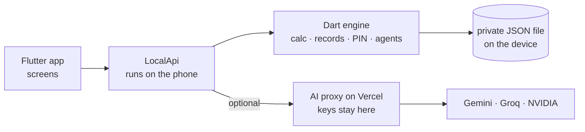

<div align="center">


# Amana AI

**Trusted records and fair pay for women who work from home.**
*امانہ: گھر سے کام کرنے والی خواتین کے لیے قابلِ اعتماد ریکارڈ اور منصفانہ ادائیگی*

[](https://github.com/abdul-rafay19/amana-ai-app/actions/workflows/build-apk.yml)


[**Download the APK**](https://github.com/abdul-rafay19/amana-ai-app/releases) ·
[Web version (Streamlit)](https://amana-ai.streamlit.app/) ·
[Web repo](https://github.com/abdul-rafay19/amana-ai)

</div>

---

## The problem

Millions of women in Pakistan earn from home: stitching, embroidery, handicrafts. They work on **piece-rate orders from contractors**, usually agreed over a phone call or a WhatsApp voice note. Nothing is written down, so:

- they cannot easily tell whether an offer is **worth their time**;
- when payment comes **short**, there is **no record** to point to;
- the phone is often **shared**, so private records are not safe.

## What Amana AI does

Amana is a voice-first work companion. She says (or types) the order in Urdu, Roman Urdu or English, and Amana helps her through five steps:

| Step | What happens |
|---|---|
| **1. Describe** | Chat or speak the order. A small ticket fills in live: pieces, rate, material cost, hours, deadline, payment terms. |
| **2. Review** | Plain numbers: total payment, what is left after costs, **earning per hour**. Risk flags (no payment date, high costs, tight deadline). An optional counteroffer message. |
| **3. Record** | Nothing is saved until she presses **Confirm**. The agreement gets a tamper-evident fingerprint. |
| **4. Payment** | She enters what she received (advance, agreed deductions, partial payment, optional photo of the slip). |
| **5. Report** | Amana shows exactly how much is **unexplained**, and drafts a polite message she can edit and approve. |

## Why it can be trusted

- **The AI never does the maths.** Totals, hourly rate and payment differences are computed by plain, tested code. The AI only understands language and writes wording.
- **A safety gate checks every AI sentence.** If it contains a number that is not in the facts, or an accusing word, it is thrown away and a fixed template is used instead.
- **She stays in control.** Nothing is saved without Confirm. Messages are **never sent automatically**: she approves the text and WhatsApp opens only when she taps.
- **Tamper-evident records.** Each saved agreement is SHA-256 hashed and chained to the previous one. If a stored record is changed, the app shows a red badge, names the changed field, and refuses to build a payment report on it. (A hash detects changes after saving; it does not prove the original information was true, and the app says so.)
- **Shared-phone Safe Mode.** A 4-digit PIN, auto-lock after idle time, lock when the app was in the background, and a lockout after 5 wrong tries.
- **Works without internet.** A rule-based engine understands common order phrasing, so the app keeps working if the AI is unreachable.

## Screens

| Work | Records | Safe mode |
|---|---|---|
| Voice or text chat, live order ticket, numbers, flags, counteroffer, payment report | Totals, hash-chain check, per-order integrity badge, tamper demo | PIN, auto-lock, notification-privacy preview |

An **AI view** (menu, "How Amana works") lists every model call and every code step, labelled `AI`, `CODE` or `CHECK`, so anyone can see who did what.

The whole interface is bilingual with full right-to-left layout for Urdu.

## How it is built



- **Everything important runs on the phone**: the maths, the records, the PIN, the offline parser and the agents. Data never leaves the device except the text sent to the AI.
- **AI is optional and hidden from users.** A tiny serverless proxy holds the API keys, so **no key is ever inside the APK or this repo**. If the proxy is unreachable the app silently continues with its built-in rules.
- **Agents:** an Orchestrator (understands the chat), Deal Intelligence (numbers, flags, counteroffer), Work Record (tamper-evident saving) and Payment Discrepancy (compare and explain). Each tool call is logged to the AI view.

### Tech stack

Flutter · Dart · `provider` · `http` · `crypto` · `record` · `flutter_tts` · `image_picker` · `google_fonts` · Vercel serverless (Node 18+) · Gemini / Groq (Whisper) / NVIDIA models · GitHub Actions

## Repository layout

```
mobile/                  Flutter app
  lib/engine/            calc, offline parser, agents, hash-chained records, PIN, LLM client
  lib/services/          LocalApi (on-device backend) and app state
  lib/screens/           Work, Records, Safe mode, AI view, splash, lock
  lib/widgets/           design system and the Amana logo
  assets/brand/          logo (SVG + PNG), wordmark, splash preview
  test/                  golden tests + full journey tests
ai-proxy/                Vercel serverless AI proxy (chat + voice), holds the keys
.github/workflows/       builds the APK and publishes it under Releases
```

## Getting started

**Requirements:** Flutter (stable), Android Studio or the Android SDK.

```bash
cd mobile
flutter pub get
flutter analyze
flutter test          # 19 tests: engine vs reference answers + the whole worker flow
flutter run           # Android device or emulator
```

The app runs fully without any AI setup (rule-based mode).

### Turn on AI and voice

1. Deploy `ai-proxy/` on Vercel (Root Directory = `ai-proxy`, Framework = Other).
2. In Vercel, add environment variables: `GROQ_API_KEY`, `GEMINI_API_KEY` (and optionally `NVIDIA_API_KEY`), plus `APP_TOKEN` (any long random text). Redeploy.
3. Open `https://<your-project>.vercel.app/api/health`. You should see `"ai": true`.
4. Build the app with your address:

```bash
flutter build apk --release \
  --dart-define=AI_PROXY_URL=https://<your-project>.vercel.app \
  --dart-define=AI_PROXY_TOKEN=<your APP_TOKEN>
```

Test the proxy code locally with no keys: `cd ai-proxy && node test.js`.

### Get the APK without a computer

Every push to `main` builds a release APK on GitHub Actions and publishes it under **Releases** ("Amana AI - latest APK"). Open the Releases page on your phone and download `app-release.apk`.

To include AI in that build, add two repository secrets (Settings, Secrets and variables, Actions): `AI_PROXY_URL` and `AI_PROXY_TOKEN`.

## Honest limits

- The PIN protects against a casual user of a shared phone. The data file is **not encrypted**.
- A chat in progress is kept in memory; saved records are stored on the phone.
- A hash chain detects later changes; it cannot prove the original figures were true.
- Voice needs internet and the AI proxy. Everything else works offline.
- AI free tiers have quotas that can change; the app falls back to built-in rules when they run out.
- Estimates come from the numbers the worker gives. They are not guaranteed earnings and Amana never gives legal advice.

## Roadmap

- Encrypt the on-device data file.
- Share a payment summary as a PDF.
- More languages (Sindhi, Punjabi, Pashto).
- iOS build.

## Related

- Web version (Streamlit): [amana-ai.streamlit.app](https://amana-ai.streamlit.app/) · [source](https://github.com/abdul-rafay19/amana-ai)

---

<div align="center">

Built with care for the women whose work holds households together.

</div>